# Mentenaz Forge — Zed Developer Cockpit

> **An experimental developer cockpit built directly into Zed — exploring what happens when the tools surrounding the editor become part of the editor itself.**


Mentenaz Forge is a personal research fork of [Zed](https://github.com/zed-industries/zed) exploring a broader developer environment built on **Rust and GPUI**.

The project brings together project environments, package management, databases, visual workflows, GitHub, Git insights, process monitoring and system health as native parts of the Zed workspace.

This is **not a collection of mock panels or a UI-only prototype**.

The systems described here are implemented as working Rust/GPUI components and integrated into Zed's existing application and workspace architecture.

> **Important:** This is an unofficial personal fork and is **not affiliated with, endorsed by, or associated with Zed Industries.**

---

# What I Built

Forge explores what a developer environment could look like when the tooling normally scattered across separate applications becomes part of the editor.

| Area                         | What Forge explores                                           |
| ---------------------------- | ------------------------------------------------------------- |
| **Developer Cockpit**        | Central operational view of the development environment       |
| **Visual Workflow Engine**   | Executable visual workflows with branching and error handling |
| **Database Workbench**       | SQLite, PostgreSQL, MySQL and MSSQL in one workspace          |
| **Runtime Management**       | Node, .NET, Python and Rust project tooling                   |
| **Package Management**       | npm, NuGet, pip and Cargo package workflows                   |
| **Rust / Cargo Manager**     | crates.io search, outdated deps and OSV advisories            |
| **GitHub / Helm**            | Native GitHub client and repository Workspace browsing        |
| **Git Insights**             | Repository activity, changed files and collaborators          |
| **Dashboard**                | Project, dependency, Git and system health                    |
| **Process Monitor**          | CPU, RAM, disk, network and process management                |
| **SQL Language Server**      | Experimental native SQL tooling                               |
| **Designer / Script Runner** | Additional development utilities                              |
| **GPUI Extensions**          | Zoom, pan and fit-view support for visual tooling             |

The important part isn't the number of features.

**It is that these systems are implemented as native Rust/GPUI components and integrated into the existing Zed workspace architecture.**

---

# A Look Inside Forge

The best way to understand the project is to see it running.

These screenshots are an **inside look at the actual development environment**, rather than concept art or static product mockups.

---

## Developer Cockpit

The Cockpit is the central operational surface for Forge.

It brings together information about the project, development environment and machine into a single workspace.


The idea is to make the development environment something that can be **observed and operated**, rather than simply used as a place to edit files.

---

## Dashboard

The Dashboard provides a higher-level view of the current development environment.


**It brings together:**

- Runtime versions (Node, .NET, Python and Rust)
- Security findings
- Outdated dependencies
- Git status
- Project state
- System health

An important design principle is that the dashboard distinguishes between:

**Healthy → Unknown → Failed**

For example, a project that hasn't been scanned should not silently appear healthy.

Likewise, a missing project or failed operation should be visible rather than hidden behind an empty state.

---

# Visual Workflow Engine

One of the central experiments in Forge is a native visual workflow system.


Workflows are represented as JSON and rendered as an interactive GPUI graph.

**The workflow system supports:**

- Sequential execution
- Conditions
- `if / else`
- Loops
- Try / catch
- Error paths
- Variables
- Environment variables
- HTTP actions
- Port waiting
- Action results
- Execution state
- Per-node results

**The graph is backed by a dedicated:**

```text
workflow_engine
```

crate.

That distinction is important.

The graph is not simply a diagram of what a workflow _could_ do.

**It represents an executable workflow.**

A development workflow can therefore look conceptually like:

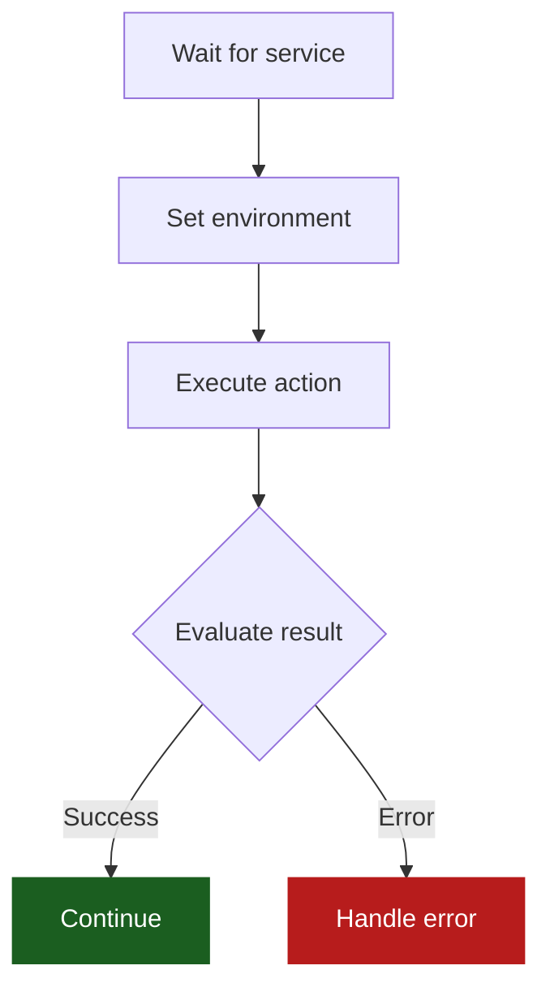

**The broader experiment is:**

> **What happens when workflow automation becomes a native capability of the development environment?**

---

# Database Workbench

Forge includes a database workspace designed around the idea that databases should be a first-class part of the development environment.

### Supported databases

- SQLite
- PostgreSQL
- MySQL
- Microsoft SQL Server

Multiple database connections can exist simultaneously.


**The Database Workbench includes:**

- Connection management
- Schema explorer
- Tables
- Columns
- Relationships
- SQL workbench
- Schema visualization
- Relationship graphs

### SQL Workbench


The database visualization also shares the broader graph concepts being explored within Forge.

---

# Runtime & Project Management

Forge provides dedicated development tooling for common project environments.

Each panel targets the active project and watches it on disk: when a manifest
or lockfile changes — an install from a terminal, a scaffold, or a hand edit —
the affected panel rescans its projects and reloads that project's data on its
own.

---

## Node


**The Node tooling provides project-aware operations including:**

- Runtime information
- Project targeting
- Run
- Build
- Test

The goal is to make the active development target explicit instead of requiring every operation to begin with manually constructed terminal commands.

---

## .NET


**The .NET tooling provides:**

- Solution selection
- Project targeting
- `dotnet run`
- Development workflow integration

---

## Python


**The Python tooling provides:**

- Environment setup
- Project targeting
- Python environment management

---

## Rust

Rust is the language Forge is written in, so its panel is built as a
daily driver rather than a breadth exercise.

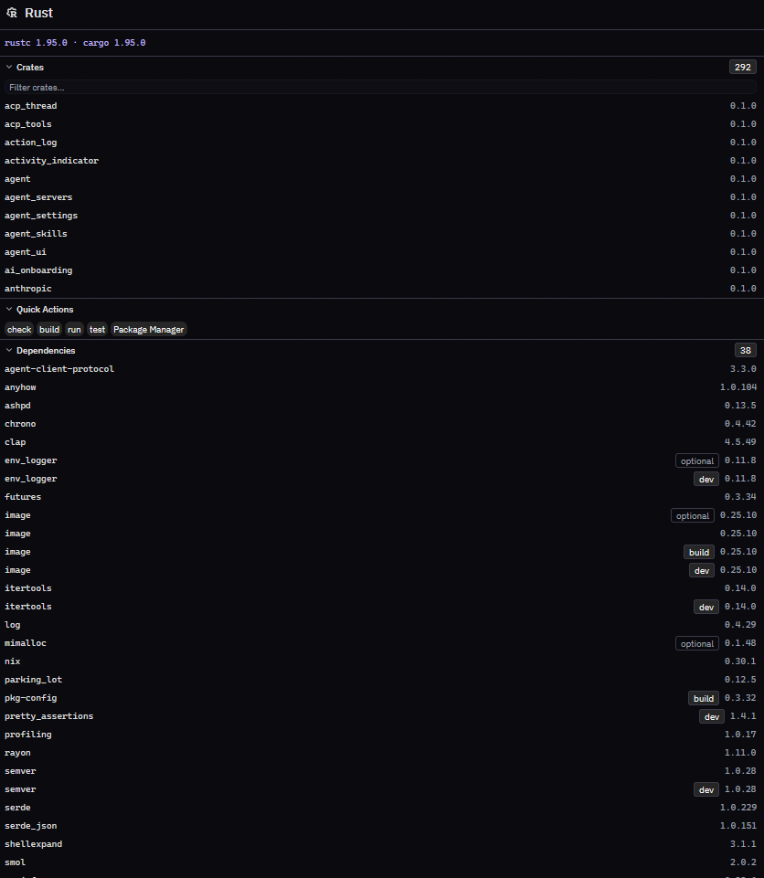

**The Rust tooling provides:**

- `rustc` and `cargo` toolchain information
- Crate and workspace targeting
- `check`, `build`, `run` and `test`
- The crate's dependencies and their locked versions
- Outdated versions, tagged by how far the version moves
- Security advisories from the RustSec database, via OSV.dev

The panel deliberately does not depend on `rust-analyzer`. It reads
`Cargo.toml` and `Cargo.lock` directly, so it works with no Rust file open and
updates when those files change.

---

# Package Management

Dependency management is treated as part of the development environment rather than a separate application.

---

## npm


**The npm tooling includes:**

- Package search
- Install
- Update
- Remove
- Version information
- Vulnerability scanning
- Inline README viewing

---

## NuGet


The NuGet tooling provides package discovery and management directly inside Forge.

---

## Python / pip


Python package management is integrated with the Python environment tooling.

---

## Cargo

The Cargo manager is the Rust counterpart to the npm and NuGet managers.


**The Cargo tooling includes:**

- crates.io package search
- Add a dependency
- Update and update-all
- Remove a dependency
- Version information, including each version's minimum supported Rust version
- Vulnerability scanning from the RustSec database, via OSV.dev
- Inline README viewing

Every action is confirmed first — an update shows Cargo's own dry-run, a
remove says when the root manifest will change too, and an add says what Cargo
will write. Dependencies inherited from `[workspace.dependencies]` are shown
but not re-versioned, because no Cargo command edits that table safely.

---

# GitHub — Helm

Forge includes **Helm**, a native GitHub client implemented as part of the developer workspace.

### Helm Home

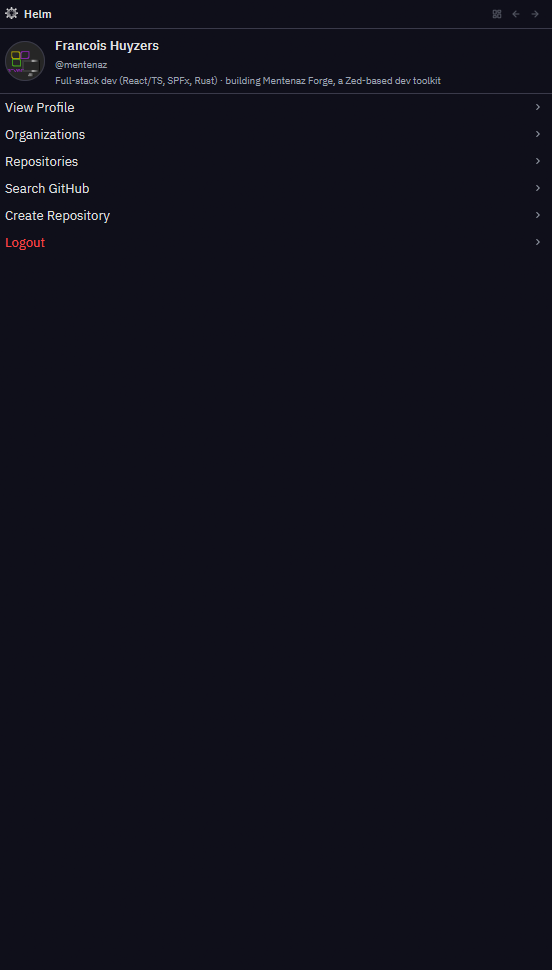

### Helm Profile

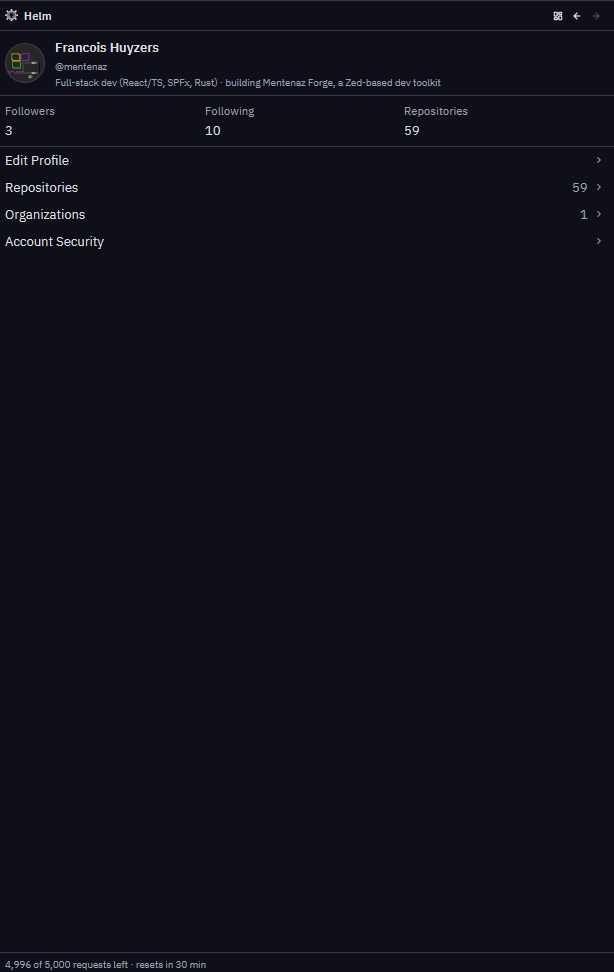

### Helm Edit Profile

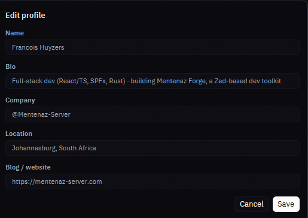

### Helm Org List

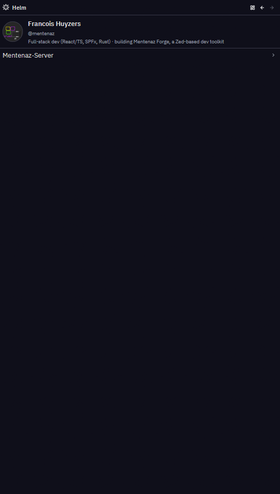

### Helm Org Page

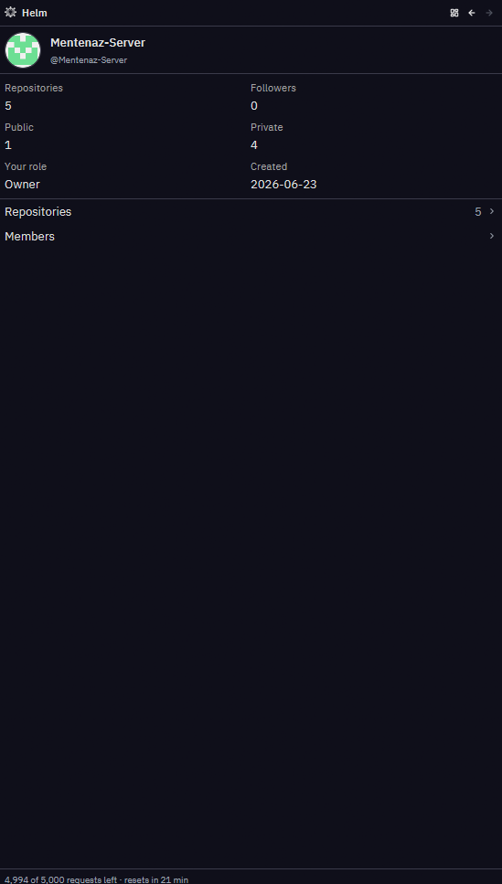

### Helm Org Repos


### Helm Repos

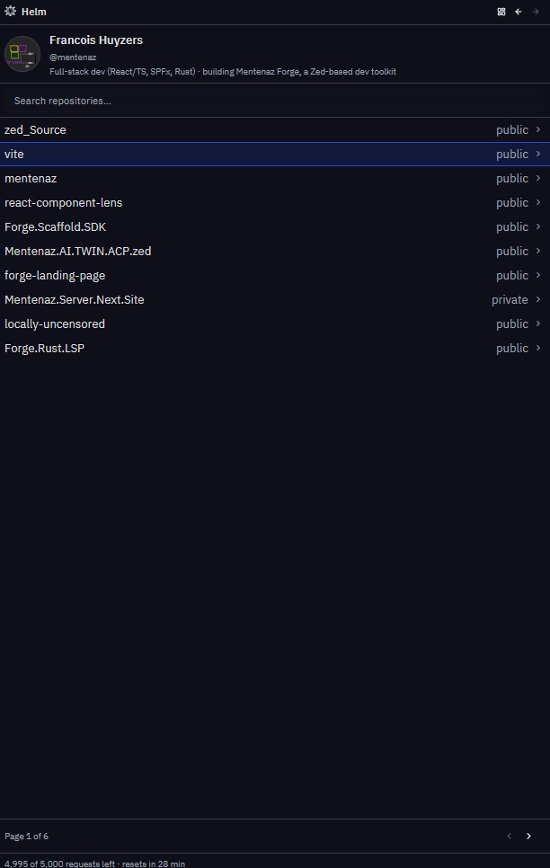

### Helm Repo Search

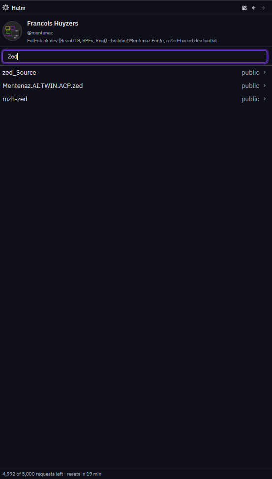

### Helm Repo Detail

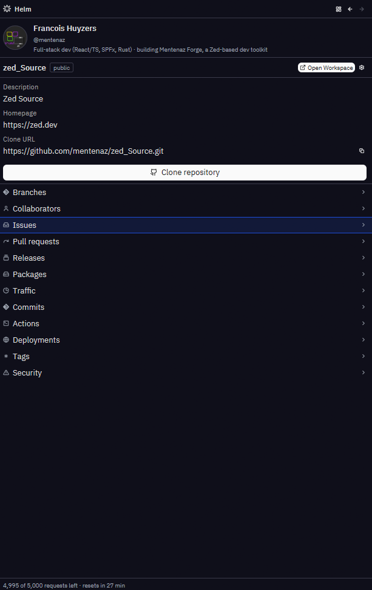

### Helm Repo Traffic

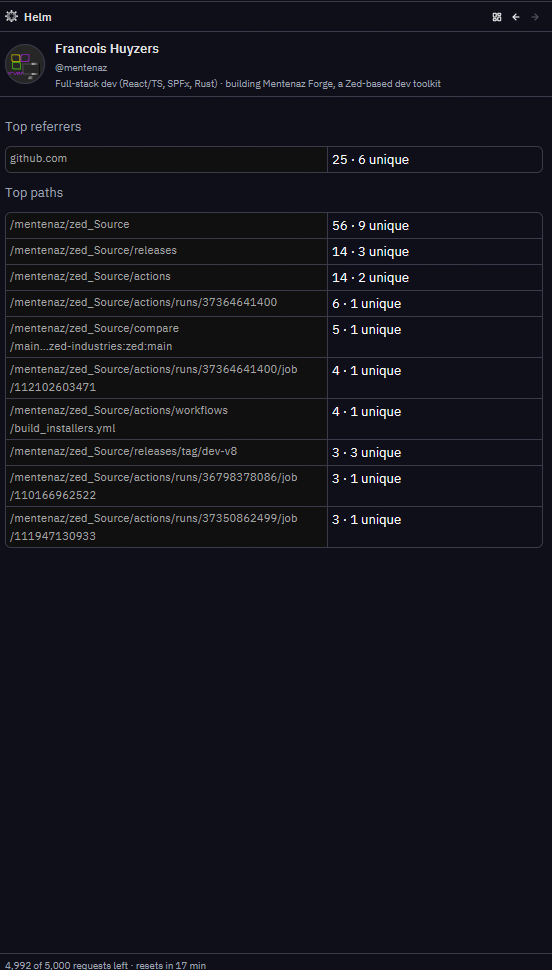

### Helm Repo Branches

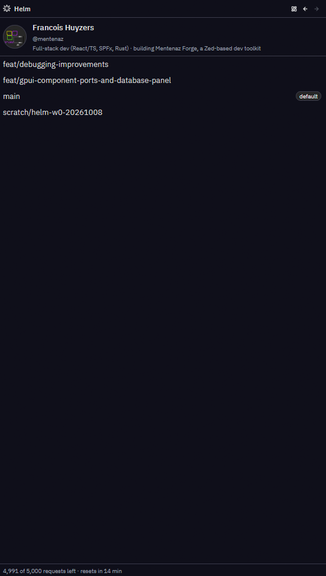

### Helm Repo Collaborators

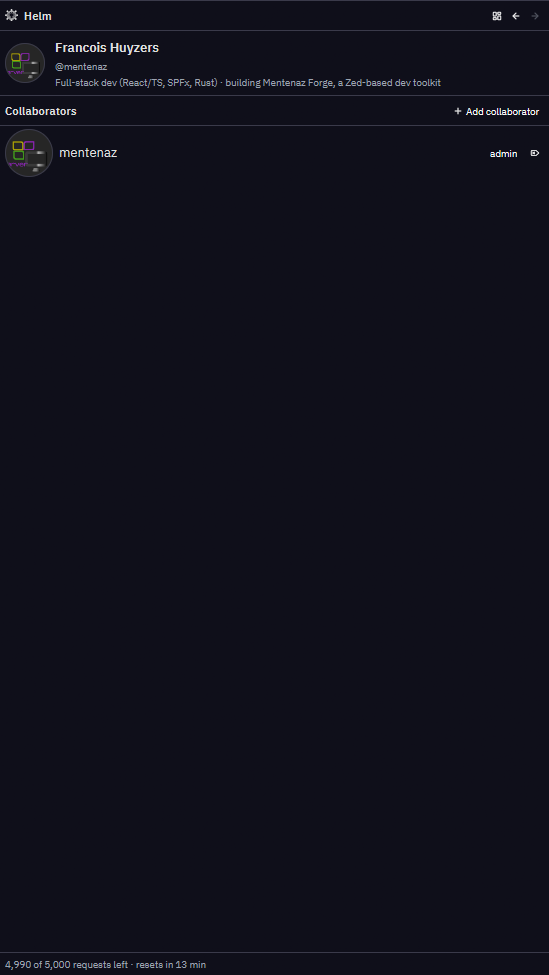

### Helm Repo Releases

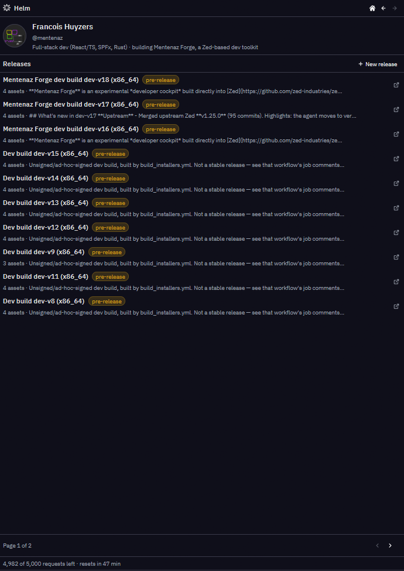

### Helm Clone Repository


### Helm Clone — Folder Chosen


### Helm Clone — Cloning


Helm currently provides:

- Profile viewing and editing
- Organizations and organization repositories
- Repository search
- Repository browsing
- Repository editing — description, homepage and topics
- Repository inspection — branches, collaborators, issues, pull requests, releases, packages, traffic, commits, actions, deployments, tags and security
- Clone operations with a folder picker
- Working-directory integration

### Repository Workspace

Beyond the detail screens, Helm opens a read-only **Workspace** tab for a
repository.


**The Workspace tab provides:**

- A repository overview
- A keyboard-navigable file tree with a local name filter
- README rendering for the repository and for the selected folder
- Syntax-highlighted file preview, image previews, and GitHub permalinks at the
  exact commit
- Paged commit history, per-file history, and commit diffs in a read-only editor
- Comparison of commits and changed files between two refs
- Repository- and ref-scoped code search
- Opening files from a matching local checkout, or cloning the repository when
  none is open

Credentials are stored using the operating system's secure credential/keychain facilities.

The intended workflow is:

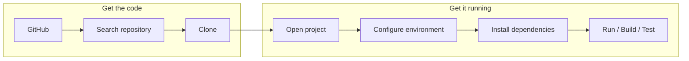

The goal is to remove unnecessary boundaries between **source control and development**.

---

# Git Insights

Forge extends the Git experience with a Details view that provides higher-level repository information.


The Details view includes information such as:

- Commit activity
- Most-changed files
- Collaborators

This is intended to complement the normal Git workflow with a more contextual view of the repository.

---

# Processes & System Monitoring

Forge also exposes the machine underneath the development environment.


The Processes tooling provides:

- CPU usage
- RAM usage
- Per-core CPU metrics
- Disk information
- Network information
- Running processes
- Process termination

This creates an interesting feedback loop:

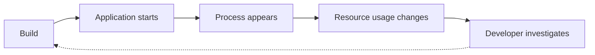

The development environment can therefore expose both **what the developer is building** and **what the machine is doing as a result**.

---

# Script Runner

Forge includes a dedicated script execution surface.

### Script Runner Idle


### Script Runner Running With link navigate and copy


The purpose is to make commonly used development operations accessible from the workspace while still allowing the underlying commands and workflow to remain explicit.

---

# Why I Built This

Forge started with a simple question:

> **What happens when the tools surrounding a code editor become part of the editor itself?**

Most development environments require a developer to move between:

- Code editor
- Terminal
- Git client
- GitHub
- Package managers
- Database clients
- Process monitors
- Runtime managers
- Workflow systems
- System tools

Forge explores whether those boundaries can be reduced.

Rather than building the experiment as a separate application, I chose to implement it **directly inside Zed's Rust/GPUI architecture**.

That decision changed the nature of the project.

Building the features required working across:

- UI architecture
- Rust
- GPUI
- Workspace architecture
- Project management
- Git
- Package management
- Databases
- Process management
- Language tooling
- GitHub APIs
- Application integration

The result is both a product experiment and a technical exploration.

---

# Design & Engineering Principles

Forge is guided by several principles.

### Native First

Tooling should feel like part of the editor rather than an external application bolted onto it.

### Information Should Be Actionable

A dashboard should not simply tell the developer that something is wrong.

It should provide enough context to understand and operate on that state.

### Visualizations Should Represent Real Systems

The workflow graph represents an executable workflow.

The database graph represents actual schema relationships.

Visual UI should correspond to real underlying state.

### Complexity Should Be Progressive

Simple operations should remain simple.

More detailed information should become available when the developer needs it without overwhelming the primary workflow.

### Prototype in the Real Product

Ideas are explored directly in Rust/GPUI and the actual application architecture rather than being limited to static design artifacts.

This allows interaction, architecture and implementation constraints to influence one another during development.

---

# Built on Zed's Architecture

Forge is deliberately implemented **inside the Zed codebase** rather than as an external application communicating with Zed.

The project therefore interacts directly with existing Zed infrastructure including:

- GPUI
- Workspace
- Project
- Git
- Git UI
- Languages
- Settings
- JSON schema infrastructure
- Remote infrastructure
- Filesystem infrastructure
- Icons
- Paths

This makes the project substantially deeper than simply adding independent UI panels.

---

# GPUI Improvements

Forge also required extending GPUI for its visual tooling.

One of the changes adds:

- Zoom
- Pan
- Fit-to-view scaling

to the graph/visualization experience.

The intention is to eventually isolate and validate this work as a potential **upstream contribution to GPUI**.

Forge therefore acts as a practical environment for identifying limitations and exploring improvements in the underlying UI framework.

---

# Architecture

Forge is divided into dedicated Rust crates rather than placing the entire implementation inside one large application module.

Some of the major components include:

```text
cockpit_panel
dashboard_panel

database_backend
database_panel

flows_panel
workflow_engine

node_panel
dotnet_panel
python_panel
rust_panel

npm_manager_panel
nuget_manager_panel
python_manager_panel
cargo_manager_panel
cargo_backend

processes_panel

helm_backend
helm_panel
helm_ui
helm_workspace

script_runner_panel
designer_panel
```

This allows individual systems to maintain their own domain logic while integrating with the broader Zed workspace and UI architecture.

The architecture is intentionally experimental.

Some components are mature enough for regular use, while others are prototypes exploring where the concepts could go next.

---

# How Forge Fits Together

The individual systems are useful on their own.

The more interesting experiment is what happens when they become part of the same environment.

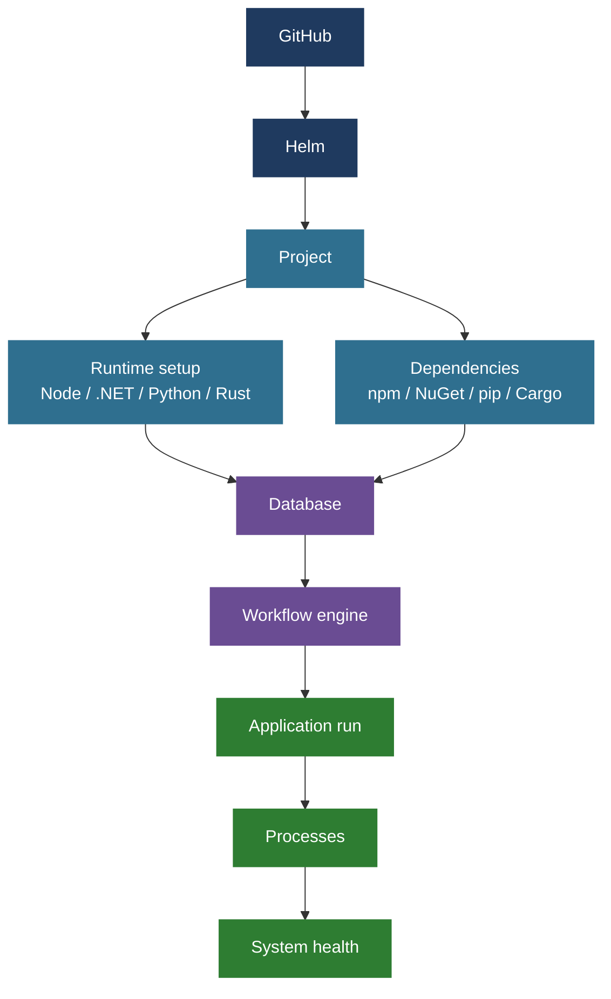

The long-term idea is to turn these into **connected developer capabilities rather than isolated utilities**.

---

# What Changed in Zed

Existing Zed areas modified or extended include:

- `gpui`
- `workspace`
- `git`
- `git_ui`
- `project`
- `settings`
- `settings_content`
- `json_schema_store`
- `languages`
- `zed`
- `fs`
- `icons`
- `paths`
- `remote`

Forge also introduces dedicated crates for the new developer tooling.

The fork therefore represents an exploration of how deeply a developer cockpit can integrate with the architecture of a native editor.

---

# Current Status

Forge is currently:

- Developed and tested primarily on Windows
- Built directly from the Zed source tree
- Functional across the major developer-tooling areas described above
- Still experimental
- Tested primarily through hands-on usage
- Limited in automated test coverage

Some areas are more mature than others.

### Known limitations

- Workflow tooling is functional but evolving.
- Database tooling is functional but evolving.
- GPUI graph functionality continues to be refined.
- SQL language-server completion remains rough.
- Cross-platform testing is not yet complete.
- Automated test coverage is currently limited.
- Releases are unsigned development builds, not a polished public release (see Build).
- macOS builds are produced by CI but have not been tested.

The repository should therefore be viewed as an **active research and engineering project**, rather than a finished commercial product.

---

# What I Am Exploring

The purpose of this fork is not to claim that every feature belongs in Zed.

It is an exploration of:

- Native developer tooling
- Rust application architecture
- GPUI
- IDE interaction design
- Visual workflow systems
- Database tooling
- Developer environment management
- System observability
- GitHub integration
- Cross-tool developer workflows
- Native application UX

The interesting question is how these pieces interact when they share the same environment.

---

# Build

This repository is intended primarily for development and experimentation.

To build the project, follow Zed's Windows development instructions:

[Zed Windows Build Guide](docs/src/development/windows.md)

The current development and testing environment is Windows.

Unsigned development builds for Windows, Linux and macOS can also be produced
by the [`build_installers`](.github/workflows/build_installers.yml) workflow:
run it manually from the Actions tab, or push a tag matching `dev-v*` to
publish a prerelease. The builds are unsigned, so each platform warns on first
run (SmartScreen on Windows, Gatekeeper on macOS). Windows is the tested
platform; the Linux and macOS builds come from the same workflow but have not
been tested by hand.

---

# Relationship to Zed

This repository is a personal research fork of Zed.

It is **not an official Zed project**.

It is not affiliated with, endorsed by, sponsored by, or otherwise associated with Zed Industries.

The original Zed project can be found at:

https://github.com/zed-industries/zed

---

# Licensing

The combined work is distributed under **GPL-3.0-or-later**, inherited from the Zed crates modified by this project.

Relevant components retain their applicable original licensing:

- `gpui` and GPUI component libraries — Apache-2.0
- `gpui_flow` — MIT © Adib
- Forge-specific code — see the applicable crate and repository licensing information

See the repository license files for the exact terms.

---

# Mentenaz Forge

This repository is part of the broader **Mentenaz Forge** experiment.

Forge explores the idea of a **developer cockpit / developer OS** where the tools surrounding software development become part of the development environment itself.

The Zed fork is the native Rust/GPUI implementation of that idea.

**This project is intentionally experimental.**

The goal is to explore how far a code editor can evolve into a complete developer workspace while retaining the speed, native performance and composability of the underlying platform.
